# Abstract

Internet of Things (IoT) devices such as sensors, smart locks and meters are cheap,
always connected and often poorly protected, which makes them an easy target for
attackers. This project, **SecureIoT-Sim**, is a software-only simulation of a Smart
Building, written entirely in Python. The building has eight virtual devices of four
types (temperature sensors, door locks, energy meters and motion sensors), a gateway
that works like an MQTT publish/subscribe broker, and a cloud server with a REST API,
an SQLite database and a web dashboard. No hardware is needed.

We first built the system with no security at all and attacked it with eight real
attacks: sniffing, tampering, replay, spoofing, password brute force, flooding the
gateway, flooding the API and unauthorised door commands. All eight succeeded (100%).
We then secured the system in four layers:

* cryptography: AES-256-GCM, HMAC-SHA256, ECDSA signatures, challenge-response device
  authentication, and key storage, rotation and revocation;
* access control and privacy: bcrypt passwords with lockout, role-based access control,
  topic-level broker permissions, rate limiting and four privacy techniques;
* cloud security: JWT authentication, input validation, encrypted database fields, and
  an audit log with alerts.

Finally we re-ran **exactly the same attack code** against the secured system. Six
attacks were fully blocked (0% success). The two flooding attacks were limited to 2%
and about 12%, because a rate limiter lets a small burst through by design. No attack
still succeeded. All numbers are measured from the running system, and a live control
panel lets the whole before/after comparison be repeated in the browser with one click.
We also compare the project with a real incident, the Mirai botnet of 2016.

**Keywords:** IoT security, smart building, MQTT, AES-GCM, HMAC, ECDSA, RBAC, JWT,
differential privacy, k-anonymity, DDoS, Mirai.

# 1. Introduction and objectives

## 1.1 Problem statement

A modern building uses many connected devices: temperature sensors for heating and
cooling, smart door locks for access control, energy meters for billing and motion
sensors for lighting and occupancy. These devices talk to a gateway and a cloud
service, and people control them through a web dashboard. If this chain is not
protected, an attacker on the building network can read private data, change sensor
values, open doors, take over accounts or overload the system.

Testing such attacks on real buildings or real devices is dangerous and, without
permission, illegal. A simulation lets us build the whole chain on one laptop, attack
it safely, add defences and measure the difference.

## 1.2 Objectives

1. Build a software-simulated IoT system with at least 4 device types and 8 devices, a
   gateway/broker and a cloud server (Smart Building scenario).
2. Attack the unsecured system with at least four realistic attacks and record the
   "before" results. Model the threats with a security requirements table, an attack
   tree and a fault tree.
3. Secure the system with cryptography (Module 2), access control and privacy
   (Module 3) and cloud security (Module 4).
4. Re-run all attacks against the secured system and show the before/after difference
   with a table and a graph.
5. Compare the project with one real IoT security incident.
6. Deliver clean, commented code with one entry point, a README and pinned
   requirements.

## 1.3 Scope and assumptions

* Everything runs on `127.0.0.1` (the laptop's loopback address). The attack code
  refuses any other address, so no real network, website or device is touched.
* The devices are Python threads that behave like real sensors. They do not run real
  firmware.
* The attacker can listen to, change and inject traffic on the building network (a
  man-in-the-middle position), can guess passwords, can control one hijacked device and
  may hold a low-privilege (viewer) account.
* Libraries: Python 3.9+, `cryptography`, `PyJWT`, `bcrypt`, `Flask`, `sqlite3`,
  `matplotlib` and `networkx`, as suggested in the brief.

# 2. Background

## 2.1 Security challenges in IoT

IoT devices have little memory and processing power. They are often shipped with
default passwords, rarely updated, and connected to the internet for years. The OWASP
IoT Top 10 [1] lists the most common weaknesses. These include:

* weak, guessable or hard-coded passwords;
* insecure network services;
* insecure interfaces;
* lack of a secure update mechanism;
* insufficient privacy protection;
* insecure data transfer and storage;
* insecure default settings.

The Mirai botnet (Chapter 8) showed how quickly such weaknesses can be abused on a
large scale [12].

## 2.2 Publish/subscribe messaging

Many IoT systems use MQTT [11], a publish/subscribe protocol. Devices *publish*
messages on *topics* such as `building/floor1/temperature/temp-01`. Other clients
*subscribe* to topics, using wildcards such as `building/#`, and a *broker* forwards
each message to every matching subscriber. Our gateway implements the same model over
TCP, using one JSON message per line.

## 2.3 Cryptographic building blocks

| Primitive | Purpose | Used for |
|---|---|---|
| AES-256-GCM [2] | Authenticated encryption: confidentiality plus a 16-byte integrity tag | Device messages, database fields, keystore |
| ChaCha20-Poly1305 [6] | Alternative authenticated cipher, fast without AES hardware | Benchmark comparison only |
| SHA-256, HMAC-SHA256 [3] | Hashing, and keyed integrity checks | Message MAC, challenge-response, pseudonyms |
| HKDF [5] | Derives several independent keys from one master key | Per-device encryption, MAC and authentication keys |
| ECDSA P-256 [4] | Digital signatures (proof of origin) | Signed door commands from the cloud |
| bcrypt [8] | Slow, salted password hashing | User passwords |
| JWT (HS256) [7] | Signed, expiring access tokens | API authentication |

## 2.4 Access control and privacy

*Role-based access control (RBAC)* gives each user a role, and each role a fixed set of
permissions, so that every user gets only the access they need (least privilege). For
privacy, we use:

* *pseudonymisation*: replacing identities with keyed codes;
* *aggregation*: publishing averages instead of raw values;
* *differential privacy* [9]: adding calibrated random noise;
* *k-anonymity* [10]: generalising records so that each one matches at least k − 1
  others.

# 3. System design

## 3.1 Architecture

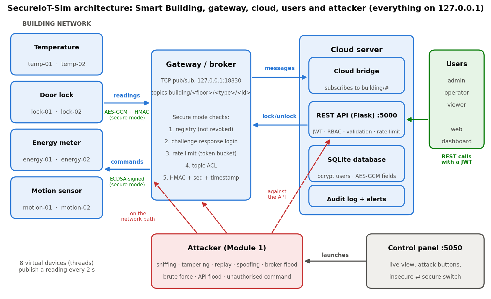

The system has four layers (Figure 1):

1. **Devices:** eight threads that publish a reading every 2 seconds. Door locks also
   subscribe to their own command topic.
2. **Gateway:** the publish/subscribe broker on TCP port 18830.
3. **Cloud:** a bridge that subscribes to `building/#` and stores every reading in
   SQLite, plus a Flask REST API with the dashboard on port 5000.
4. **Users:** admin, operator and viewer accounts that use the dashboard.

The attacker (Module 1) and a control panel for the live demo (port 5050) sit outside
the building.

## 3.2 Components

| Component | File(s) | Role |
|---|---|---|
| Devices | `core/devices.py` | `TemperatureSensor`, `DoorLock`, `EnergyMeter`, `MotionSensor` |
| Broker | `core/broker.py` → `module2_crypto/crypto_broker.py` → `module3_access/secure_broker.py` | Insecure broker, extended with the crypto checks and then the access checks |
| Client | `core/client.py`, `core/channel.py`, `module2_crypto/secure_channel.py` | Connect, handshake, publish/subscribe; plain or secure channel |
| Cloud bridge | `core/cloud_bridge.py` | Stores readings, sends lock/unlock commands |
| Cloud API | `core/cloud_insecure.py` / `module4_cloud/secure_api.py` | Insecure and secure REST APIs plus the dashboard |
| Database | `core/database.py` | Tables: devices, users, readings, commands, audit_log, alerts |
| Attacks | `module1_attacks/*.py` | Eight attacks, the MITM relay and the attack runner |
| Simulation | `core/simulation.py`, `main.py`, `compare.py` | Builds the building, runs modes and the comparison |
| Live demo | `core/live.py`, `core/control_panel.py` | Continuous traffic, attack buttons, mode switch |

## 3.3 Insecure baseline vs secured system

| Aspect | Insecure baseline | Secured system |
|---|---|---|
| Messages on the network | Plain JSON | AES-256-GCM ciphertext + HMAC-SHA256 + sequence number + timestamp |
| Device identity | Broker believes any claimed id | Registered devices only; challenge-response with a per-device key |
| Topics | Anyone may publish or subscribe to anything | Topic ACL: devices use only their own topic |
| Door commands | Lock obeys any command | Lock obeys only ECDSA-signed, fresh, never-seen commands |
| Passwords | Stored and compared in plain text | bcrypt (cost 12) + lockout + password policy |
| API access | No authentication, forgeable token | JWT (15 min) + RBAC + validation + rate limits |
| Database | Plain text | E-mails and door/motion readings AES-GCM encrypted |
| Monitoring | None | Audit log, ten alert rules, admin dashboard |

## 3.4 Secure message format

In secure mode every message is an *envelope* with three parts:

* `hdr` (header): `from` (sender), `dev` (key owner), `seq` (sequence number), `ts`
  (timestamp), `kv` (key version) and `nonce`;
* `ct`: the AES-256-GCM ciphertext of the reading. The header and the topic are bound
  to it as additional authenticated data, so neither can be changed or moved;
* `mac`: an HMAC-SHA256 over header, topic and ciphertext.

Each device key is split with HKDF into separate encryption, MAC and authentication
keys. The gateway checks the MAC first, then the timestamp (at most 30 s old), then that
the sequence number is newer than the last one seen for that sender.

## 3.5 Technology stack and project structure

The project is pure Python 3.9+ with six pinned libraries (Flask 3.1.3,
cryptography 50.0.2, PyJWT 2.10.1, bcrypt 5.0.0, matplotlib 3.9.4, networkx 3.2.1).
The code is split into one package per module:

* `core/`: the simulated building;
* `module1_attacks/`: threats and attacks;
* `module2_crypto/`: cryptography;
* `module3_access/`: access control and privacy;
* `module4_cloud/`: cloud security;
* `tests/`: unit tests;
* `docs/`: documentation;
* `results/`: generated outputs.

Every function has a docstring.

## 3.6 Live simulation and control panel

Besides the console commands, `python main.py --mode secure --live` keeps the building
running in the browser:

* the devices keep sending readings every 2 seconds;
* the control panel shows every frame crossing the gateway (readable in insecure mode,
  ciphertext in secure mode);
* any attack can be launched with a button;
* a switch restarts the building in the other mode;
* a before/after table collects the measured results of both modes.

# 4. Module 1: Threats and attacks

*Owner: Vansh Dabas (09519051723)*

## 4.1 Assets and attacker model

The assets are:

* the door locks (physical access);
* the sensor data (temperature, energy, and motion, which reveals occupancy);
* user accounts and device keys;
* the cloud database;
* the availability of the service.

The attacker model is described in Section 1.3.

## 4.2 Security requirements

| ID | Property | Requirement | Attack it addresses | Secure-mode control |
|---|---|---|---|---|
| SR-01 | Confidentiality | Readings and commands unreadable to eavesdroppers | Sniffing | AES-GCM (M2) |
| SR-02 | Integrity | Any change in transit is detected and dropped | Tampering | GCM tag + HMAC-SHA256 (M2) |
| SR-03 | Freshness | A captured message is never accepted twice | Replay | Timestamp window + sequence numbers (M2, M3) |
| SR-04 | Device authentication | Only registered devices that prove their key may connect | Spoofing | Challenge-response (M2), registry (M3) |
| SR-05 | Command authenticity | Locks act only on commands signed by the cloud | Forged commands | ECDSA P-256 (M2) |
| SR-06 | User authentication | Salted, hashed passwords; online guessing limited | Brute force | bcrypt + lockout (M3), login rate limit (M4) |
| SR-07 | Authorisation | Least privilege for users and devices | Unauthorised commands | RBAC, topic ACL (M3), JWT (M4) |
| SR-08 | Availability | One client cannot exhaust the gateway or API | Flooding | Token buckets at broker (M3) and API (M4) |
| SR-09 | Key management | Secure random keys, protected storage, rotation, revocation | Key theft | Keystore, rotation, revocation list (M2) |
| SR-10 | Data at rest | Sensitive database fields encrypted | Database theft | AES-GCM field encryption (M4) |
| SR-11 | Privacy | Shared data does not identify rooms, devices or people | Re-identification | Four privacy techniques (M3) |
| SR-12 | Accountability | Security events logged; suspicious patterns raise alerts | All (detection) | Audit log + alerts (M4) |
| SR-13 | Input validation | Malformed or out-of-range input rejected | Injection, crashes | Validation on every endpoint (M4) |

## 4.3 Attack tree

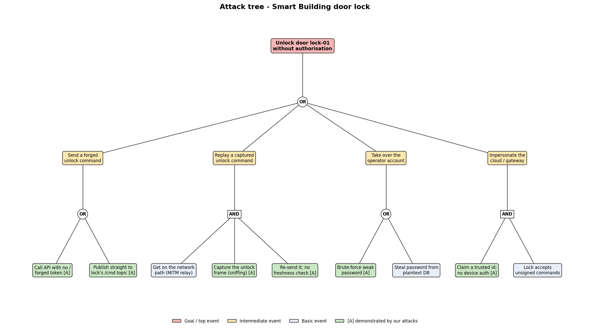

The attacker's goal is to open door lock-01 without permission (Figure 2). There are
four OR-branches:

1. send a forged unlock command, either through the API without a valid token or
   directly to the lock's command topic;
2. replay a captured unlock command. This is an AND of three steps: get on the network
   path, capture the frame, and re-send it while there is no freshness check;
3. take over the operator account, by brute force or by stealing the plain-text
   password database;
4. impersonate the cloud. This is an AND of claiming a trusted id and the lock accepting
   unsigned commands.

Every leaf marked [A] is one of our simulated attacks, and every leaf is countered by at
least one requirement in Section 4.2.

## 4.4 Fault tree

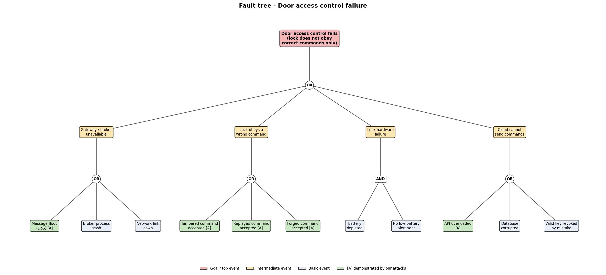

The fault tree (Figure 3) looks at the same lock from a reliability point of view. The
top event, "door access control fails", has four causes:

* the gateway is unavailable (flood, crash or link failure);
* the lock obeys a wrong command (tampered, replayed or forged);
* the lock hardware fails (battery depleted AND no low-battery alert);
* the cloud cannot send commands (API overloaded, database corrupted, or a valid key
  revoked by mistake).

Our security controls remove the malicious events. The accidental ones are listed as
future work.

## 4.5 Simulated attacks

| Attack | How it works in the simulation | "Success" means |
|---|---|---|
| Sniffing | A man-in-the-middle relay records 20 readings between devices and the gateway | The reading is readable on the wire |
| Tampering | The relay changes 10 temperature readings (or flips a ciphertext bit) | The modified value is stored by the cloud |
| Replay | A real operator "unlock lock-01" frame is captured and re-sent 5 times | The lock unlocks again |
| Spoofing | A fake client claims to be `temp-01` and sends 10 readings | The fake reading is stored |
| Brute force | 99 common passwords are tried against `operator1` | A valid login token is obtained |
| Broker flooding | A hijacked `energy-02` sends 1000 messages as fast as it can | Flood messages accepted |
| API flooding | 10 threads send 300 requests with a viewer token | Requests answered |
| Unauthorised command | Viewer token, no token, forged admin JWT (`alg: none`) and a direct broker publish all try to unlock `lock-02` | The lock unlocks |

All success rates are counted from the running system: database rows, lock state,
broker counters and HTTP replies. No result is typed in by hand.

## 4.6 "Before" results (insecure baseline)

| Attack | Attempts | Successes | Success rate |
|---|---|---|---|
| Sniffing | 20 | 20 | 100% |
| Tampering | 10 | 10 | 100% |
| Replay | 5 | 5 | 100% |
| Spoofing | 10 | 10 | 100% |
| Brute force | 59 | 1 (password found at guess 59) | 100% |
| Broker flooding | 1000 | 1000 | 100% |
| API flooding | 300 | 300 | 100% |
| Unauthorised command | 4 | 4 | 100% |

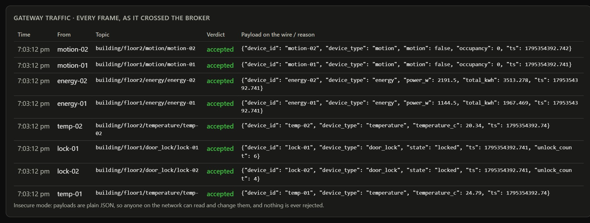

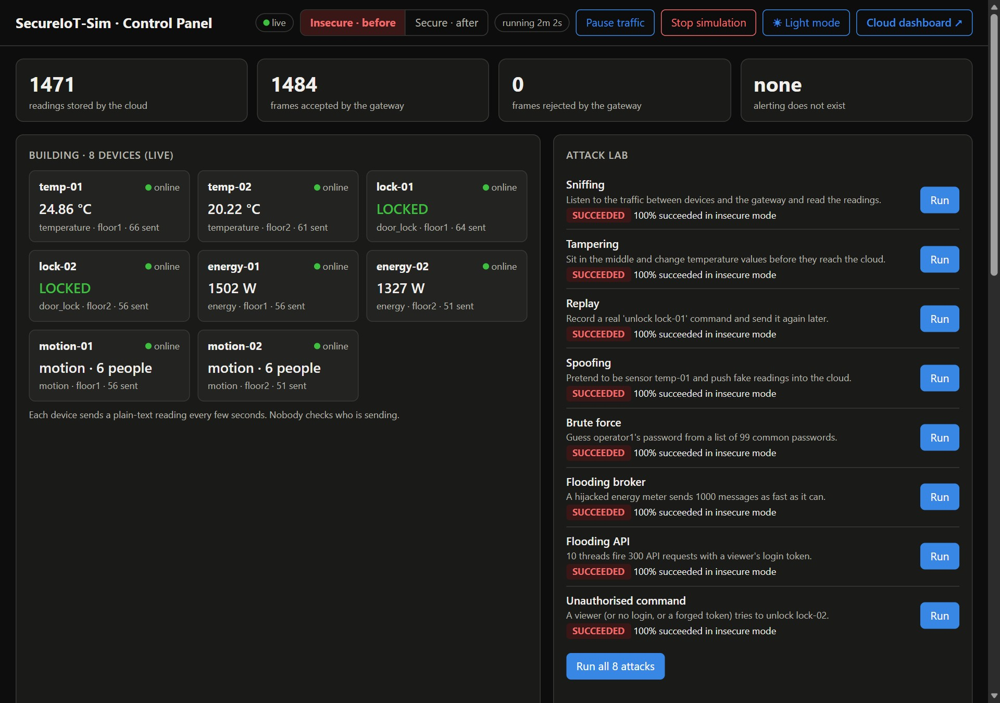

# 5. Module 2: Cryptography

*Owner: Sadia Mohd. Khan (12219051723)*

## 5.1 Message encryption with AES-256-GCM

Every reading is encrypted with AES-256 in Galois/Counter Mode (`module2_crypto/aes_gcm.py`).
GCM gives confidentiality and a 16-byte authentication tag in one step. A fresh 12-byte
random nonce is used for every message, and the header and topic are passed as
additional authenticated data. The cloud stores only what it can decrypt and verify.
An eavesdropper sees only the `ct` field (Figure 6).

## 5.2 Integrity with SHA-256 and HMAC

On top of the GCM tag, the gateway checks an HMAC-SHA256 over the header, topic and
ciphertext (`module2_crypto/integrity.py`), using a separate MAC key. The gateway can
reject a modified message without decrypting it. Comparisons use constant time
(`hmac.compare_digest`), so timing does not leak information.

## 5.3 Digital signatures with ECDSA

The cloud holds an ECDSA P-256 private key. Every lock/unlock command is signed
(`module2_crypto/signatures.py`). Each lock has the cloud's public key and accepts a
command only if:

* the signature is valid;
* the command is less than 30 seconds old;
* its unique `cmd_id` has not been seen before.

A forged or replayed command is therefore ignored by the lock itself, even if it gets
past the network.

## 5.4 Secure random key generation

All keys come from the operating system's secure random source (Python `secrets` and
`os.urandom`): 256-bit device keys, nonces, challenges and the JWT secret. HKDF derives
the separate encryption, MAC and authentication keys from each device key
(`module2_crypto/keygen.py`).

## 5.5 Key management: storage, rotation, revocation

| Function | Implementation (`module2_crypto/key_manager.py`) |
|---|---|
| Storage | All device keys and the cloud's signing key are kept in `data/keystore.enc`, encrypted with AES-256-GCM under a master key (environment variable or `data/master.key`). The file contains no readable key bytes. |
| Rotation | A new key version becomes current; the old one stays valid for 60 s so messages already in flight are not lost. Messages carry the key version (`kv`). |
| Revocation | A revoked device's keys are deleted and its id goes on a revocation list. The gateway disconnects it and refuses every reconnect. It can be re-registered with a brand-new key. |

In the demo, `temp-01` was rotated from v1 to v2 and its next reading was accepted.
`motion-02` was revoked, refused on reconnect, then re-registered with key v2. The
control panel offers the same actions as buttons.

## 5.6 Challenge-response device authentication

When a device connects, the gateway sends a random one-time challenge. The device
answers with HMAC(auth key, "device id | challenge"), which proves it holds the key
without ever sending the key (`module2_crypto/challenge_response.py`). A spoofing client
that only knows the device's name fails this test.

## 5.7 Comparison of two ciphers

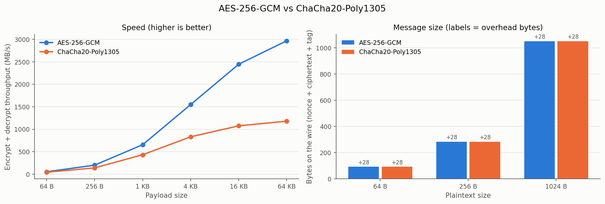

| Payload | AES-256-GCM (MB/s) | ChaCha20-Poly1305 (MB/s) | Bytes on the wire (both) |
|---|---|---|---|
| 64 B | 52.1 | 41.7 | 92 (28 B overhead) |
| 1 KB | 654.1 | 431.3 | 1052 |
| 16 KB | 2446.1 | 1074.7 | 16 412 |
| 64 KB | 2968.0 | 1178.4 | 65 564 |

Both ciphers add the same 28 bytes per message (a 12-byte nonce and a 16-byte tag), so
size does not decide between them. On this laptop AES-GCM was 1.2× to 2.5× faster,
because the processor has hardware AES instructions (AES-NI). On small IoT chips
without AES hardware, ChaCha20-Poly1305 is usually the faster choice. That is why both
are standard in TLS 1.3. We chose AES-256-GCM.

## 5.8 Results

With Module 2 in place, the following attacks were blocked:

* sniffing: 0/20 readable;
* tampering: 0/10 stored ("HMAC check failed");
* replay: 0/5 ("replayed message (old sequence number)");
* spoofing: 0/10 ("challenge-response failed (wrong key)").

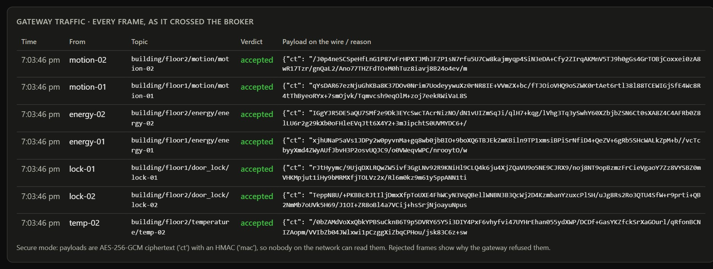

# 6. Module 3: Access control and privacy

*Owner: Abubakar Siddiqui (08019051723)*

## 6.1 Registration and revocation

The registry (`module3_access/registry.py`) registers devices (with a new key) and
users (with a bcrypt hash and an encrypted e-mail), and can revoke either. Some
examples:

* a test account `contractor1` could log in (HTTP 200) until it was revoked, after which
  login gave HTTP 403 (account disabled);
* revoked devices are refused at the gateway.

## 6.2 Salted password hashing and lockout

Passwords are hashed with bcrypt at cost 12 (about 210 ms per hash). bcrypt includes a
random salt, so hashing the same password twice gives two different hashes, and both
verify correctly. New passwords must pass a policy: at least 12 characters, an
upper-case letter and a symbol, and not on a common-password list. After 5 wrong
passwords the account is locked for 5 minutes, and even the correct password then
returns HTTP 423.

Unknown users and wrong passwords get the same reply. A dummy hash is checked for
unknown users, so the response time does not reveal which usernames exist.

## 6.3 Role-based access control

| Permission | viewer | operator | admin |
|---|---|---|---|
| read_readings | yes | yes | yes |
| send_command | – | yes | yes |
| manage_devices | – | – | yes |
| manage_users | – | – | yes |
| view_audit | – | – | yes |

## 6.4 Broker with topic-level permissions

The secure broker (`module3_access/secure_broker.py`) checks a topic ACL on every
publish and subscribe:

* a device may publish only on its own topic;
* a door lock may subscribe only to its own command topic;
* only the cloud may subscribe to `building/#` and publish commands.

In the demo, `temp-01` was refused when it tried to publish on `temp-02`'s topic, and
when it tried to subscribe to `building/#`.

## 6.5 Rate limiting

Both the gateway and the API use a token bucket (`module3_access/rate_limit.py`):

| Client | Burst | Refill |
|---|---|---|
| Each device, at the gateway | 20 messages | 5 per second |
| The cloud, at the gateway | 200 messages | 100 per second |
| Login, per IP and username | 10 attempts | 1 every 10 seconds |
| Each user, at the API | 20 requests | 5 per second |

## 6.6 Privacy techniques

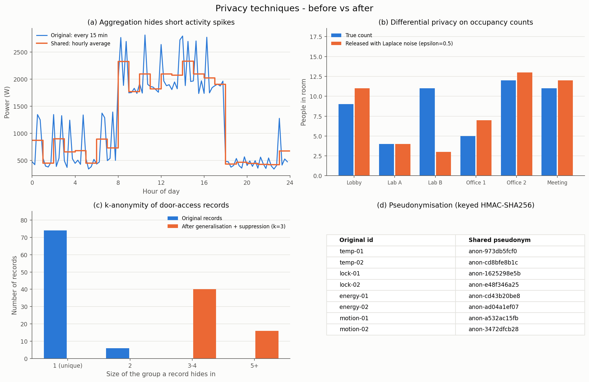

| Technique | How | Result |
|---|---|---|
| Pseudonymisation | Device ids replaced with keyed HMAC-SHA256 codes | A dictionary attack re-identified 8/8 plain SHA-256 ids but 0/8 keyed pseudonyms |
| Aggregation | 15-minute energy readings averaged per hour | 96 → 24 points; peak 2813 → 2331 W hides short events; daily total kept (28.98 kWh) |
| Differential privacy | Laplace noise (ε = 0.5) added to room occupancy counts | Mean error 1.67 people per room; individual presence hidden |
| k-anonymity | Door-access log: names removed and the remaining fields generalised into broader groups, k = 3 | Unique records 74/80 → 0; 24 records suppressed |

The cloud also exports a privacy-safe analytics file (`results/analytics_export.csv`)
with pseudonymised device ids, built from the real readings.

## 6.7 Results

With Module 3 in place:

* brute force failed: 0/99. The replies were HTTP 401 ×5, then 423 ×5 (locked), then
  429 ×89 (rate limited);
* broker flooding was limited to 20/1000 messages (2%);
* the viewer's attempt to send a command was refused by RBAC;
* the rogue client was refused by the gateway.

# 7. Module 4: Cloud security

*Owner: Vedant Mishra (11819051723)*

## 7.1 REST API

| Endpoint | Permission |
|---|---|
| `POST /api/login`, `POST /api/logout` | none / any valid token |
| `GET /api/devices`, `/api/readings`, `/api/dashboard` | read_readings |
| `POST /api/command` | send_command |
| `GET /api/alerts`, `/api/audit` | view_audit |
| `GET/POST/DELETE /api/users` | manage_users |
| `GET /dashboard` | page; data needs a JWT |

## 7.2 API authentication with JWT

A successful login returns a JWT signed with HS256. The signing secret is a random
256-bit secret, created each time the cloud starts. The token is valid for 15 minutes
and carries `sub`, `role`, `iat`, `exp`, `jti` and `iss`. The server accepts only
HS256, so tokens claiming `alg: none` are rejected. It also requires every claim,
refuses expired tokens, and remembers logged-out token ids. In the demo:

* a viewer token edited to say `admin` was refused (HTTP 401), because its signature no
  longer matched;
* a real viewer token on `/api/audit` gave HTTP 403.

## 7.3 Input validation and hardening

Every input is checked against an allow-list (`module4_cloud/validation.py`):

* device ids must look like `lock-01`;
* commands must be `lock` or `unlock`;
* `limit` must be a whole number from 1 to 200.

A command with an SQL-injection id was refused with HTTP 400, and so was
`limit=999999`. Request bodies over 4 KB get HTTP 413. Every response carries security
headers (`X-Content-Type-Options`, `X-Frame-Options`, `Referrer-Policy`,
`Content-Security-Policy`), and errors are returned as short JSON with no stack traces.
The dashboard inserts all values with `textContent`, so device data cannot inject HTML
or scripts.

## 7.4 Rate limiting

The login and per-user API limits from Section 6.5 return HTTP 429. In the API flood
test, 264 of 300 requests were refused.

## 7.5 Encrypted storage

E-mail addresses and door-lock and motion readings are stored in SQLite as
`enc:v1:<AES-GCM ciphertext>`. They use a field key derived from the master key
(`module4_cloud/field_crypto.py`). Temperature and energy readings are not personal and
stay plain. An authorised admin still sees the decrypted values through the API.

## 7.6 Audit log and alerts

Every security decision (login, failed login, lockout, invalid token, permission
denied, rate limit, and gateway rejections) is written to the audit log
(`module4_cloud/audit.py`). Ten alert rules turn patterns into alerts on the admin
dashboard. Each rule has a threshold and a time window, and a 30-second cooldown stops
one attack from raising the same alert repeatedly.

| Alert | Threshold |
|---|---|
| Possible password brute force | 5 failed logins in 60 s |
| API flood: client rate limited | 10 refusals in 10 s |
| Account locked, invalid or forged token, privilege escalation (RBAC), device authentication failed, replay detected, tampering detected, topic ACL violation, device flooding the gateway | 1 event |

One secure run of all attacks raised 13 alerts.

## 7.7 Dashboard

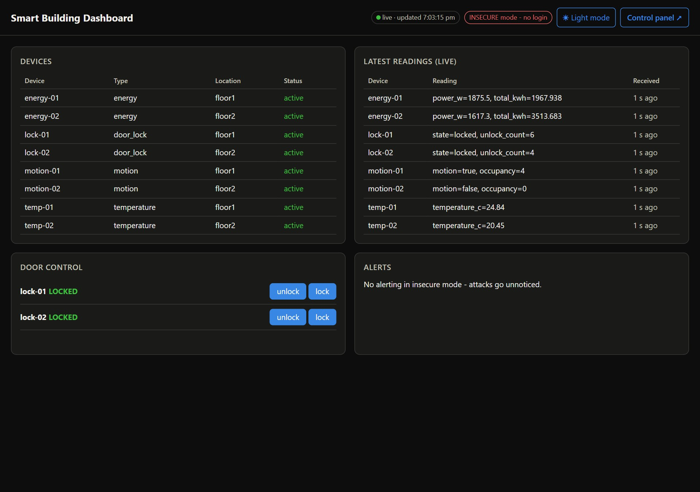

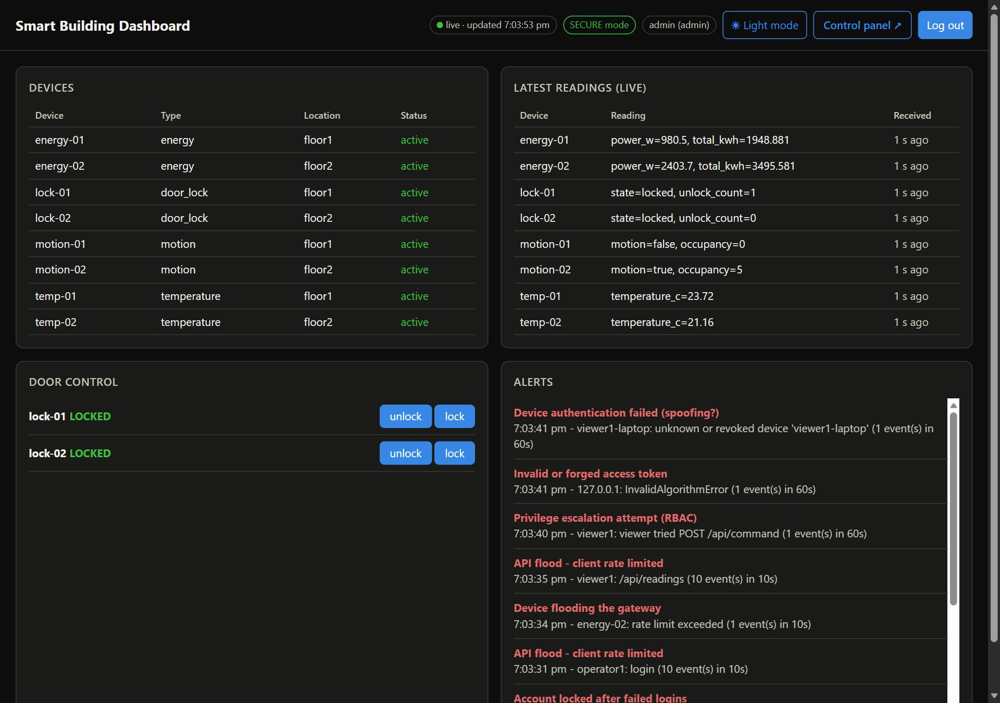

The dashboard (`module4_cloud/templates/dashboard.html`) shows:

* the devices;
* the live readings, with how many seconds ago each one arrived;
* a door-control card;
* the alerts (admin only).

The door buttons call the real API, so the same RBAC rules apply. An admin or operator
can unlock a door, while a viewer gets HTTP 403, which also raises an alert. The
dashboard has a light/dark theme switch.

# 8. Case study: the Mirai botnet (2016)

*The full case study is provided as a separate document (`docs/case_study.pdf`).*

## 8.1 Summary

Mirai was malware that scanned the internet for IoT devices, mainly IP cameras, DVRs
and routers, with Telnet open. It logged in with a built-in list of 62 factory-default
username/password pairs [12][13]. Infected devices joined a botnet of up to about
600,000 bots [12], which launched record DDoS attacks in 2016:

* about 620 Gbit/s against KrebsOnSecurity [15];
* about 1 Tbit/s against OVH;
* several waves against the DNS provider Dyn on 21 October 2016, which made sites such
  as Twitter, Netflix, Reddit and GitHub unreachable for hours [16].

The source code was published in September 2016, which led to many variants. In
December 2017 its three creators pleaded guilty [17].

## 8.2 Comparison with our project

| Mirai weakness | Our similar attack | Our defence | Measured result |
|---|---|---|---|
| Default, shared passwords; unlimited guesses | Brute force (99 common passwords) | bcrypt, lockout after 5, login rate limit, password policy | 100% → 0% |
| Devices trust any controller | Spoofing, unauthorised command | Per-device keys, challenge-response, ECDSA-signed commands, RBAC, topic ACL | 100% → 0% |
| Plain-text Telnet | Sniffing, tampering, replay | AES-256-GCM, HMAC, sequence numbers + timestamps | 100% → 0% |
| Floods with no limits | Broker and API flooding | Token-bucket rate limits + alerts | 100% → 2% / 12% |
| Nobody noticed | – | Audit log + alert rules ("possible brute force" …) | 13 alerts |
| Infected devices stay infected | – | Key rotation and revocation, re-registration | Revoked device refused |

Our simulation does not cover internet-wide scanning, real Telnet services, egress
filtering of traffic leaving the building, firmware security or terabit-scale floods.
Those need network-level and manufacturer-level measures.

## 8.3 Lessons

No default or shared credentials; disable unused services; limit and monitor login
attempts; encrypt and authenticate all traffic; make devices revocable and updatable;
and use defence in depth. These are also the core requirements of ETSI EN 303 645 [18].

# 9. Testing and before/after results

## 9.1 Test strategy

We tested at three levels:

1. **unit tests** of the security building blocks;
2. **system runs** of each mode from the single entry point;
3. **the before/after experiment**, which runs the same attack code against both modes
   in fresh buildings.

The live control panel lets the experiment be repeated in front of an audience.

## 9.2 Unit tests

The 21 unit tests (`python -m unittest discover -s tests`) all pass:

| File | Tests | What is checked |
|---|---|---|
| `tests/test_crypto.py` | 8 | AES-GCM round trip and tamper detection; HMAC; separate HKDF keys; challenge-response; ECDSA command signing and replay rejection; envelope format; key rotation, revocation and encrypted keystore |
| `tests/test_access_and_cloud.py` | 13 | bcrypt salting and the 72-byte limit; password policy; lockout (the correct password refused with 423); the same message for unknown users; RBAC; topic ACL; rate limiter; four privacy techniques; input validation; encrypted fields and tamper detection |

## 9.3 System tests

* `python main.py --mode insecure` and `--mode secure` run the normal simulation, the
  module demos and all eight attacks, and write `results/before.csv` and
  `results/after.csv`.
* `python main.py --compare` runs every attack against both modes and writes
  `results/comparison.csv`, `comparison.md` and `before_after.png`. It takes about 47 s.
* Clean-install test: the submission ZIP was unpacked into an empty folder, a new
  virtual environment was created, and `pip install -r requirements.txt` was run. Then
  the unit tests and all three commands were run on Python 3.12.10 and again on
  Python 3.11.9. All finished with exit code 0 and no errors.

## 9.4 Before/after comparison

| Attack | Insecure (before) | Secure (after) | Outcome | Defence observed |
|---|---|---|---|---|
| Sniffing | 20/20 (100%) | 0/20 (0%) | BLOCKED | Payload unreadable (encrypted) |
| Tampering | 10/10 (100%) | 0/10 (0%) | BLOCKED | HMAC check failed |
| Replay | 5/5 (100%) | 0/5 (0%) | BLOCKED | Old sequence number |
| Spoofing | 10/10 (100%) | 0/10 (0%) | BLOCKED | Challenge-response failed |
| Brute force | 1/59 (100%) | 0/99 (0%) | BLOCKED | 401 ×5, 423 ×5, 429 ×89 |
| Broker flooding | 1000/1000 (100%) | 20/1000 (2%) | PARTIAL | Rate limit exceeded |
| API flooding | 300/300 (100%) | 36/300 (12%) | PARTIAL | HTTP 429 ×264 |
| Unauthorised command | 4/4 (100%) | 0/4 (0%) | BLOCKED | 403, 401, 401, gateway refused |

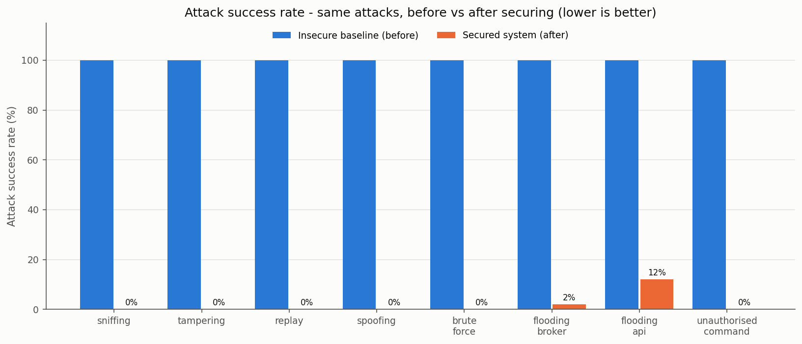

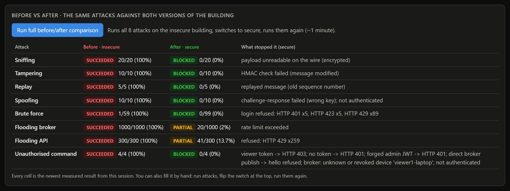

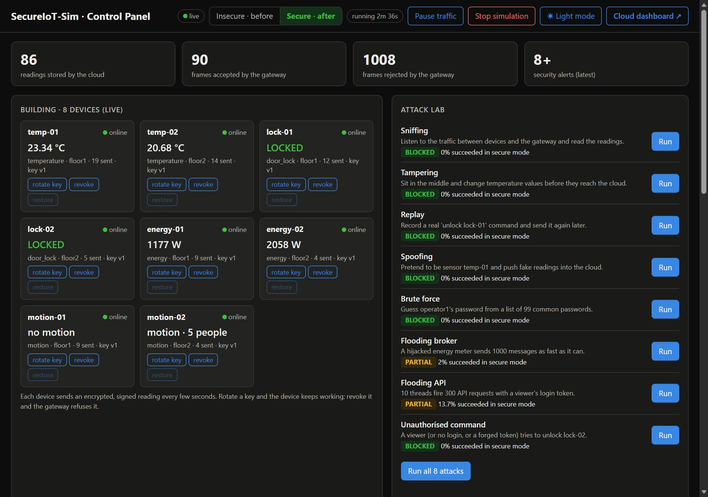

## 9.5 Discussion

* **Six attacks went from 100% to 0%.** Each was stopped by the control named in the
  requirements table, and the observed reason (for example "HMAC check failed") proves
  which control did it.
* **Flooding is limited, not zero.** A token bucket lets a short burst through (20
  messages at the gateway, about 36 requests at the API), then refuses the rest. This is
  intended, so that a normal device or user is never blocked by a small spike. The flood
  was also reported as an alert.
* **Defence in depth.** Several attacks were stopped by more than one layer. For
  example, the unauthorised command was refused by RBAC (403), by JWT verification
  (401) and by the gateway's device authentication. A forged command reaching the lock
  would still fail the ECDSA check.
* **Same weak password.** `operator1` keeps its weak password in secure mode on purpose,
  so the brute-force result shows the effect of the defences, not of a changed password.
* The numbers are stable between runs. Only the API flood varies slightly (about 12–14%)
  because of thread timing.

# 10. Conclusion and future work

## 10.1 Conclusion

SecureIoT-Sim meets every objective. It simulates a Smart Building with 8 devices of 4
types, a broker and a cloud, all in Python with no hardware. In the insecure baseline,
eight real attacks all succeeded. After adding cryptography, access control, privacy and
cloud security, the same attack code was re-run. Six attacks were fully blocked, flooding
was cut to 2% and 12%, and none still succeeded. Every number was measured from the
running system and can be reproduced with one command or one click in the live control
panel. The Mirai case study shows that these same weaknesses caused real damage in 2016,
and that the defences we built are the ones experts and new laws recommend.

## 10.2 Future work

* Use TLS with mutual certificates between devices and the gateway, instead of our own
  envelope format.
* Add secure firmware updates with signed images, and model device compromise.
* Simulate network segmentation (VLANs) and egress filtering of traffic leaving the
  building.
* Add an anomaly-detection model on the audit log, beyond fixed thresholds.
* Keep the JWT secret and master key in a hardware security module or key vault instead
  of a file, and add refresh tokens.
* Handle the reliability events from the fault tree: low-battery alerts, broker
  redundancy and database backups.
* Run on real hardware (for example Raspberry Pi devices with an MQTT broker) to compare
  performance.

# References

1. OWASP Foundation, "OWASP Internet of Things Top 10," 2018.
2. M. Dworkin, "Recommendation for Block Cipher Modes of Operation: Galois/Counter Mode
   (GCM) and GMAC," NIST SP 800-38D, 2007.
3. H. Krawczyk, M. Bellare and R. Canetti, "HMAC: Keyed-Hashing for Message
   Authentication," RFC 2104, IETF, 1997.
4. NIST, "Digital Signature Standard (DSS)," FIPS 186-5, 2023.
5. H. Krawczyk and P. Eronen, "HMAC-based Extract-and-Expand Key Derivation Function
   (HKDF)," RFC 5869, IETF, 2010.
6. Y. Nir and A. Langley, "ChaCha20 and Poly1305 for IETF Protocols," RFC 8439, IETF, 2018.
7. M. Jones, J. Bradley and N. Sakimura, "JSON Web Token (JWT)," RFC 7519, IETF, 2015.
8. N. Provos and D. Mazières, "A Future-Adaptable Password Scheme," in *Proc. USENIX
   Annual Technical Conference*, 1999.
9. C. Dwork, F. McSherry, K. Nissim and A. Smith, "Calibrating Noise to Sensitivity in
   Private Data Analysis," in *Theory of Cryptography Conference (TCC)*, 2006.
10. L. Sweeney, "k-Anonymity: A Model for Protecting Privacy," *Int. J. Uncertainty,
    Fuzziness and Knowledge-Based Systems*, vol. 10, no. 5, 2002.
11. OASIS, "MQTT Version 5.0," OASIS Standard, 2019.
12. M. Antonakakis et al., "Understanding the Mirai Botnet," in *Proc. 26th USENIX
    Security Symposium*, 2017.
13. C. Kolias, G. Kambourakis, A. Stavrou and J. Voas, "DDoS in the IoT: Mirai and Other
    Botnets," *Computer*, vol. 50, no. 7, 2017.
14. US-CERT, "Heightened DDoS Threat Posed by Mirai and Other Botnets," Alert TA16-288A, 2016.
15. B. Krebs, "KrebsOnSecurity Hit With Record DDoS," *KrebsOnSecurity*, Sept. 2016.
16. S. Hilton, "Dyn Analysis Summary of Friday October 21 Attack," Dyn blog, Oct. 2016.
17. U.S. Department of Justice, "Justice Department Announces Charges and Guilty Pleas in
    Three Computer Crime Cases Involving Significant DDoS Attacks," 13 Dec. 2017.
18. ETSI, "Cyber Security for Consumer Internet of Things: Baseline Requirements,"
    EN 303 645 V2.1.1, 2020.
19. Python Cryptographic Authority, "cryptography" library documentation; Pallets,
    "Flask" documentation; "PyJWT" and "bcrypt" documentation.

# Appendix A: Member-wise contribution

| Member | Enrollment no. | Module | Main contributions |
|---|---|---|---|
| Vansh Dabas | 09519051723 | Module 1: Threats and attacks | Simulated building (`core/`): devices, broker, client, database, cloud bridge, insecure API, live simulation and control panel. Eight attacks and MITM relay (`module1_attacks/`). Security requirements table, attack tree and fault tree. "Before" results. |
| Sadia Mohd. Khan | 12219051723 | Module 2: Cryptography | AES-256-GCM, HMAC-SHA256, HKDF keys, ECDSA signed commands, challenge-response, secure channel and crypto broker, encrypted keystore with rotation and revocation, AES-GCM vs ChaCha20-Poly1305 benchmark (`module2_crypto/`). |
| Abubakar Siddiqui | 08019051723 | Module 3: Access control and privacy | Registry, bcrypt passwords and lockout, RBAC, topic ACL and secure broker, token-bucket rate limiting, four privacy techniques and the privacy graph (`module3_access/`). |
| Vedant Mishra | 11819051723 | Module 4: Cloud security and case study | Secure Flask API with JWT, validation and rate limits, encrypted database fields, audit log and alerts, dashboard (`module4_cloud/`). Mirai case study. |
| All members | – | Integration | `main.py`, `compare.py`, before/after experiment, unit tests, README, report and presentation. |

# Appendix B: Originality and AI-use declaration

We declare that this project is the work of Group secureTeam (class IIOT-B2). As the course
rules allow, an AI assistant (Claude Code by Anthropic) was used during the project, and
we declare that use here:

* **Code:** the source code was generated with the assistant from our project brief,
  phase by phase. After each phase we ran it, checked the output and asked for changes.
  The file-by-file record is in `docs/ai_use_log.md`.
* **Documents:** the case study, this report and the presentation were drafted with the
  assistant from our project's measured results, then reviewed by the group.
* **Results:** every number, table, graph and screenshot comes from actually running the
  code. Nothing was typed in or edited by hand.
* **Understanding:** each member has studied the files of their own module and the
  overall design, and is able to explain every line in the viva.

No code or text was copied from other groups or from the internet. Sources used for
facts are listed in the References.

| Member | Enrollment no. | Signature |
|---|---|---|
| Vansh Dabas | 09519051723 | |
| Sadia Mohd. Khan | 12219051723 | |
| Abubakar Siddiqui | 08019051723 | |
| Vedant Mishra | 11819051723 | |

# Appendix C: How to run the project

```
cd secureTeam_SecureIoT-Sim
python -m venv venv
venv\Scripts\activate            (Windows)   |   source venv/bin/activate   (macOS/Linux)
pip install -r requirements.txt

python main.py --mode insecure     baseline + attacks       -> results/before.csv
python main.py --mode secure       secured system + attacks -> results/after.csv
python main.py --compare           both modes + comparison  -> results/comparison.*, before_after.png
python main.py --mode secure --live    live demo: http://127.0.0.1:5050 (control panel)
                                                 http://127.0.0.1:5000/dashboard
python -m unittest discover -s tests   21 unit tests
```

Test accounts (made-up values for this simulation only) are listed in `config.py`.
Everything runs on `127.0.0.1`.
